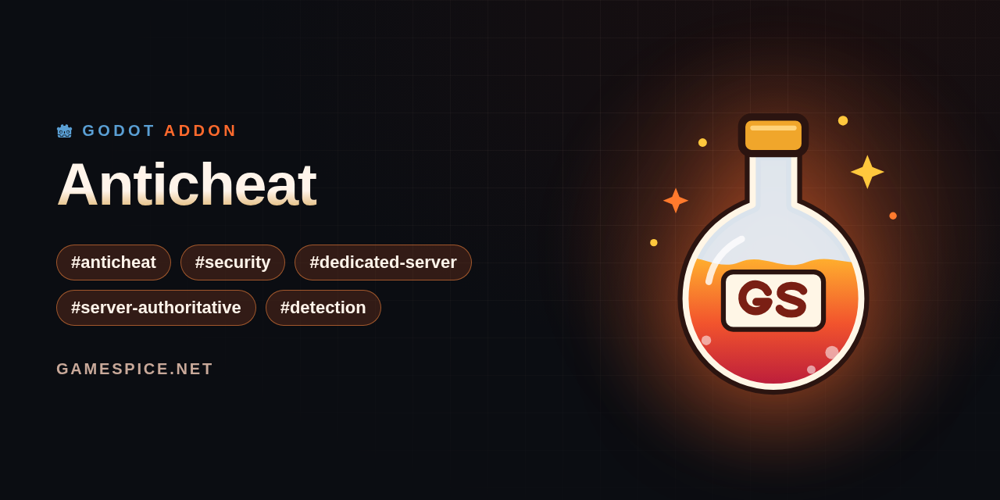

[](https://moddingcommunity.com/a/143-gs-anticheat)

Godot 4.7+ addon for server-side anti-cheat: speed, teleport and aim-snap detectors, command and state sanity checks, a suspicion score per player, and escalation through GameSpice Server Security. Nothing is trusted from the client and no driver is installed. Part of the GameSpice addon family.

This is a GameSpice addon (MIT, built with Claude Code) with an offline headless test, `res://examples/anticheat_selftest.tscn`. The games in [Zee's Games](https://zeesgames.com) run on live servers and are built on the GameSpice addons, so the platform it belongs to runs in real play.

The detectors that re-simulate movement and aim live in GameSpice Server Security. This addon is the layer on top: it adds up what they report into a score that decays, says when a player reaches a warning, kick or ban level, and offers pure sanity checks for the commands a client sends. It never acts by itself. Your game, or a Server Security rule, decides what a level means.

For review, `history(id)` returns a player's newest detections (kind, proof or suspicion, time; bounded by `history_per_player`, 0 is unlimited), `reset(id)` clears score and history after a person looked, and `to_dict()` / `load_dict()` let GameSpice Save keep the table. The addon still never acts: it says which level a player reached.

## Install

1. Copy `addons/gs_anticheat/` and `addons/gs_core/` into your project.
2. Enable GameSpice Anticheat in *Project > Project Settings > Plugins*.

## Quick start

```gdscript
var watch := GSSuspicionWatch.new()
watch.config = GSSuspicionConfig.from_files().value   # layered cfg, env and flags
add_child(watch)

# 1. Feed it from the Server Security detector (any node with a detected signal works).
watch.attach(anticheat_node)

# 2. Or report from your own checks.
var bad := watch.sanity.check_move(last_pos, new_pos, delta)
if bad != "":
    watch.report(player_id, StringName(bad))

# 3. Decide what a level means.
watch.escalated.connect(func(id, level, score):
    if level == GSSuspicion.Level.KICK:
        kick(id))
```

`GSSuspicion` and `GSCommandSanity` are plain objects too, so a headless server can use them without the node. Pass the time in seconds to `observe` and `score` to make a run repeatable.

## Settings

Every number is a field on `GSSuspicionConfig`. A value of 0 means unchecked or unlimited; the inspector ranges are slider limits, not enforced caps.

| Setting | Default | What it does |
| --- | --- | --- |
| `enabled` | true | Off, nothing is scored and every check passes. |
| `default_weight` | 1.0 | Points for a detection kind with no entry in `weights`. |
| `impossible_weight` | 100 | Points for a detection that is proof, not suspicion. |
| `decay_per_second` | 0.5 | Points forgiven each second; 0 never forgives. |
| `weights` | empty | Per-kind points as `kind=weight`. |
| `max_players` | 0 | Players tracked; 0 is unlimited. At the limit the lowest score is dropped and counted. |
| `warn_at` | 20 | Score for the warning level; 0 turns it off. |
| `kick_at` | 60 | Score for the kick level; 0 turns it off. |
| `ban_at` | 0 | Score for the ban level; 0 means never. |
| `max_speed` | 0 | Legal units per second; 0 leaves it unchecked. |
| `max_turn_rate` | 0 | Legal degrees per second; 0 leaves it unchecked. |
| `max_command_rate` | 0 | Commands per second per player; 0 leaves it unchecked. |
| `world_extent` | 0 | Largest legal coordinate on any axis; 0 leaves it unchecked. |

Layers, weakest first: the defaults, `cfg/addon/gs_anticheat/*.yml`, the game's files, the operator's files, `GS_ANTICHEAT_*` environment variables, then `--anticheat-*` flags. A value that makes no sense, such as a warning level above the kick level, fails `validate()` with a reason.

## What it is not

- Not the detectors: re-simulating movement and spotting speed, teleport and aim-snap is GameSpice Server Security's GSAntiCheat. Use it as the source and let this addon score what it reports. The configuration class here is called `GSSuspicionConfig` so it never clashes with Server Security's.
- Not a punishment system: bans, mutes and appeals are GameSpice Moderation. A level here is a signal for it, not a verdict.
- Not a client-side tool: there is no driver, no scanner and no kernel hook. Nothing the client says is trusted, and nothing runs on the player's machine.
- Not proof of cheating on its own: a high score is a reason for a human to look. The ban level is off by default for that reason.

## Test

```bash
godot --headless --path . --import
godot --headless --path . res://examples/anticheat_selftest.tscn
```

The self-test is offline and exits non-zero on any failure.

## Used by

No shipped game vendors it yet. The example scene shows how it is wired. The whole collection is at [zeesgames.com](https://zeesgames.com).

## Licence

MIT. See [LICENSE](LICENSE). Only the TMC back-end web infrastructure is not open source.
